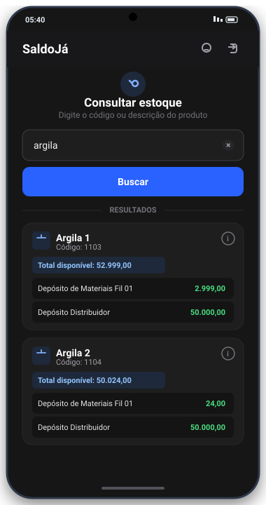
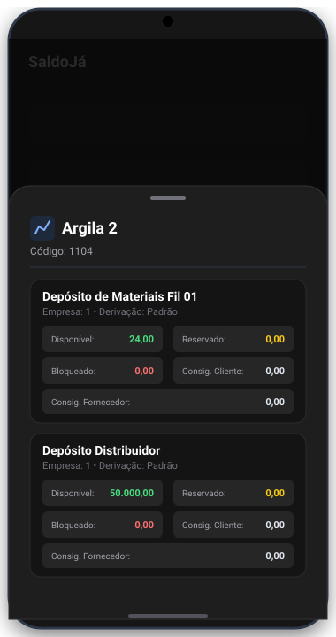
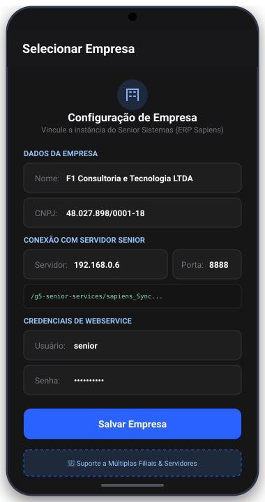
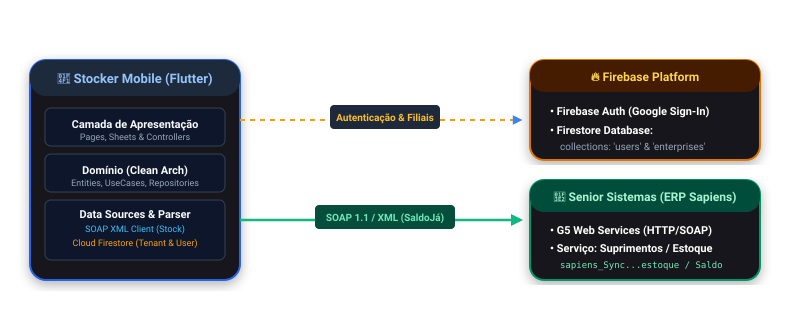

<div align="center">

  

  # Stocker (SaldoJá)
  ### Autonomia e Mobilidade para Consulta de Estoque no Senior Sistemas

  <p>
    <strong>Controle • Organize • Evolua</strong><br/>
    Aplicativo mobile desenvolvido em Flutter para consulta instantânea de saldos de estoque por filial e depósito, integrado via Web Services SOAP ao ERP Senior Sapiens.
  </p>

  <p>
    
    
    
    
    
  </p>

  <p>
    <a href="#-por-que-o-stocker-existe-o-problema-real">O Problema</a> •
    <a href="#-sobre-o-projeto">Sobre</a> •
    <a href="#-aviso-importante-sobre-a-execução-integração-senior">Aviso de Execução</a> •
    <a href="#-telas-e-demonstrações">Demonstrações</a> •
    <a href="#-arquitetura-e-fluxo-de-dados">Arquitetura</a> •
    <a href="#-integração-soap-com-senior-sistemas">Integração SOAP</a> •
    <a href="#-segurança-e-configuração">Segurança</a>
  </p>

</div>

---

## 🎯 Por que o Stocker existe? (O Problema Real)

Nas indústrias, distribuidoras e centros de distribuição que utilizam o ERP **Senior Sistemas (Sapiens / G5)**, as operações de tomada de decisão não acontecem apenas atrás de uma mesa de escritório.

> **O Cenário Comum:**  
> Gerentes de operações, supervisores de logística, diretores industriais e compradores passam grande parte do seu dia no chão de fábrica, vistoriando docas de expedição, em reuniões com fornecedores ou em trânsito.
>
> Sempre que surge uma dúvida crítica de estoque — *"Temos a matéria-prima X no Depósito da Filial 01?"*, *"Esse saldo está disponível ou já está reservado/bloqueado para faturamento?"* —, o gestor precisava:
>
> 1. Ligar ou mandar mensagem para alguém que estivesse na frente de um computador rodando o terminal pesado do ERP; ou
> 2. Interromper sua vistoria e se deslocar até uma estação fixa de trabalho.

### A Solução

O **Stocker** (também referenciado no app como **SaldoJá**) nasceu para romper essa barreira física. Trata-se de uma ferramenta móvel, leve e responsiva, que permite ao gestor **consultar saldos em tempo real diretamente do smartphone em poucos segundos**, garantindo independência operacional mesmo quando distante do software operacional desktop da empresa.

---

## 💡 Sobre o Projeto

Este aplicativo foi **idealizado e implementado por mim como um teste de conhecimento e consolidação de habilidades**, explorando os desafios práticos de engenharia de software em cenários corporativos reais:

- **Integração com sistemas legados/corporativos:** Consumo de serviços SOAP 1.1 / XML de alta volumetria e conversão para entidades tipadas em Dart.
- **Ecossistema Híbrido:** Uso do **Firebase (Auth e Firestore)** para gerenciar sessão, autenticação via Google e cadastro dinâmico de empresas/filiais (multi-tenant), desacoplado da conexão direta com o servidor local do Senior.
- **Padrões de Projeto & Clean Architecture:** Divisão rigorosa em camadas (*Data*, *Domain*, *Presentation*) e orientação a *features* para máxima testabilidade e manutenção.
- **Controle de Acesso Baseado em Papéis (RBAC):** Gestão de perfis `admin` e `user` com restrição de privilégios para cadastros de conexão.

---

## ⚠️ Aviso Importante sobre a Execução (Integração Senior)

> [!IMPORTANT]
> **Sobre a execução local:**  
> O Stocker é um aplicativo corporativo que consome o WebService proprietário do **Senior Sistemas (`sapiens_Synccom_senior_g5_f1_int_suprimentos_estoque`)**, o qual tipicamente reside na rede interna (intranet/VPN) ou gateway privado da empresa.
>
> Por esse motivo, **ao clonar este repositório sem acesso a um servidor Senior ativo, as requisições de consulta de estoque resultarão em falha de conexão**.
>
> Para demonstrar o funcionamento real da aplicação de ponta a ponta com dados reais de estoque e resposta do servidor Senior, disponibilizamos abaixo as **telas e gravações em vídeo** do aplicativo rodando.

---

## 📱 Telas e Demonstrações

O aplicativo conta com suporte dinâmico a **Tema Escuro (Dark Mode)** e **Tema Claro (Light Mode)**.

<div align="center">
  <table>
    <tr>
      <td align="center">
        <strong>Consulta de Estoque (Dark Mode)</strong><br/><br/>
        
      </td>
      <td align="center">
        <strong>Extrato Detalhado por Depósito</strong><br/><br/>
        
      </td>
      <td align="center">
        <strong>Gestão Multi-empresa (Admin)</strong><br/><br/>
        
      </td>
    </tr>
  </table>
</div>

### 🎬 Vídeos Demonstrativos em Tempo Real

No diretório [`docs/`](docs/) encontram-se gravações completas de uso do aplicativo:

- 📹 **[Vídeo 1: Fluxo do Administrador & Tema Escuro](docs/demo-dark-admin.mp4)**  
  *Demonstra login Google, cadastro de nova filial/servidor Senior (IP, porta e credenciais), busca por descrição ("argila"), detalhamento de múltiplos depósitos, consulta direta por código ("1104") e alternância de permissões de usuário na tela de administração.*
- 📹 **[Vídeo 2: Fluxo do Usuário Comum & Tema Claro](docs/demo-light-commonUser.mp4)**  
  *Demonstra login, seleção da filial ativa, experiência de consulta e visualização de saldos sob a identidade visual em modo claro.*

---

## ✨ Funcionalidades Principais

- **🔍 Busca Dinâmica por Código ou Descrição:** Digite termos como `"parafuso"`, `"argila"` ou o código interno (`1103`) para obter retornos imediatos.
- **📦 Totalização e Resumo por Depósito:** Exibe de imediato o saldo total consolidado e a lista rápida de cada depósito (com destaques de cor: verde para estoque abundante, laranja para estoque baixo e vermelho para zerado).
- **📋 Extrato Completo de Estoque (Modal Bottom Sheet):**
  - **Disponível:** Quantidade livre para venda/uso (`qtdEst`).
  - **Reservado:** Quantidade já comprometida em pedidos (`qtdRes`).
  - **Bloqueado:** Quantidade retida para controle de qualidade ou quarentena (`qtdBlo`).
  - **Consignação:** Saldo com terceiros — Consignado Cliente (`qtdCcl`) e Consignado Fornecedor (`qtdCfo`).
  - **Derivações & Empresa:** Informações de tamanho, cor ou variação de lote (`desDer`) e código da empresa vinculada (`codEmp`).
- **🏢 Multi-tenancy (Múltiplas Filiais / Empresas):**
  - Permite que uma organização com várias unidades (Matriz, Filial 1, Centro de Distribuição) cadastre diferentes IPs, portas e credenciais de webservice.
  - O usuário escolhe a filial ativa na inicialização; a sessão fica salva localmente via `SharedPreferences`.
- **👥 Gestão de Usuários (RBAC):**
  - Administradores têm acesso a uma página dedicada de gerenciamento para promover ou rebaixar usuários cadastrados com atualização em tempo real.
- **🎨 Design System Consistente:** Paleta de cores moderna (`AppColors`), tipografia escalável (`AppTextStyles`) e respeito às preferências de sistema do dispositivo (Light/Dark).

---

## 🏗️ Arquitetura e Fluxo de Dados

O projeto adota os princípios de **Clean Architecture**, isolando regras de negócio e contratos de infraestrutura externa:

<div align="center">
  
</div>

```text
lib/
├── app.dart                                  # Injeção de dependências e MaterialApp
├── firebase_options.dart                     # Configuração das plataformas Firebase
├── main.dart                                 # Entrypoint com inicializações assíncronas
│
├── core/                                     # Recursos transversais e Design System
│   ├── pages/splash_page.dart                # Roteamento inteligente de sessão
│   ├── theme/                                # AppTheme, AppColors, AppTextStyles
│   ├── utils/number_parser.dart              # Parser para numeração brasileira (pt-BR)
│   └── widgets/app_system_ui.dart            # Ajuste de status bar e navigation bar
│
├── features/
│   ├── auth/                                 # Módulo de Autenticação
│   │   ├── data/                             # AuthRemoteDataSource, AuthRepositoryImpl
│   │   ├── domain/                           # UserEntity, AuthRepository, UseCases
│   │   └── presentation/                     # AuthController, LoginPage
│   │
│   ├── company/                              # Módulo Multi-empresa / Filiais
│   │   ├── data/                             # CompanyRemoteDataSource, CompanyModel
│   │   ├── domain/                           # CompanyEntity, CompanyRepository, UseCases
│   │   └── presentation/                     # CompanyController, CompanyPage, AddCompanySheet
│   │
│   └── stock/                                # Módulo de Consulta de Estoque
│       ├── data/                             # StockRemoteDataSource (SOAP), StockRepositoryImpl
│       ├── domain/                           # StockEntity, StockResult, StockRepository
│       └── presentation/                     # StockController, HomePage, StockDetailSheet, UserManagementPage
│
└── shared/
    └── services/company_session_service.dart # Persistência local da empresa selecionada
```

---

## 🔌 Integração SOAP com Senior Sistemas

A comunicação com o ERP ocorre via requisições HTTP POST direcionadas ao endpoint de serviços do Senior Sapiens G5:

```text
http://{server}:{port}/g5-senior-services/sapiens_Synccom_senior_g5_f1_int_suprimentos_estoque
```

### 1. Envelope de Requisição (SOAP 1.1)

```xml
<soapenv:Envelope xmlns:soapenv="http://schemas.xmlsoap.org/soap/envelope/" xmlns:ser="http://services.senior.com.br">
  <soapenv:Header />
  <soapenv:Body>
    <ser:Saldo>
      <user>{seniorUser}</user>
      <password>{seniorPassword}</password>
      <encryption>0</encryption>
      <parameters>
        <codDes>{termo_de_busca}</codDes>
      </parameters>
    </ser:Saldo>
  </soapenv:Body>
</soapenv:Envelope>
```

### 2. Tratamento e Parser da Resposta XML

O DataSource analisa o XML retornado utilizando a biblioteca `xml`:

1. **Verificação de Erro da Camada Senior:** Intercepta a tag `<erroExecucao>` e mapeia mensagens amigáveis de conexão ou credenciais.
2. **Extração de Itens:** Percorre os nós `<produtos>` capturando `codPro`, `desPro`, `desDep`, `codEmp`, `desDer` e as quantidades (`qtdEst`, `qtdRes`, `qtdBlo`, `qtdCcl`, `qtdCfo`).
3. **Agrupamento em Memória:** Agrupa diferentes linhas de depósitos sob a mesma `StockEntity` correspondente ao produto, preparando os dados para a exibição hierárquica.

---

## 🔒 Segurança e Boas Práticas (.gitignore)

Para preservar a integridade do código e proteger credenciais sensíveis de infraestrutura, o repositório segue regras estritas de isolamento:

1. **Credenciais do Firebase:** Arquivos como `google-services.json` e `GoogleService-Info.plist` estão devidamente incluídos no [`.gitignore`](.gitignore).
2. **Templates de Exemplo:** Foram criados os arquivos de referência:
   - [`android/app/google-services.json.example`](android/app/google-services.json.example): Estrutura esperada pelo plugin Google Services.
   - [`lib/firebase_options.example.dart`](lib/firebase_options.example.dart): Molde de configuração das opções do Firebase.
3. **Chaves de Assinatura & Ambiente:** Bloqueio de arquivos `*.keystore`, `*.jks`, `key.properties`, `local.properties` e arquivos de ambiente `.env`.

---

## 🚀 Como Executar o Projeto Localmente

### Pré-requisitos

- [Flutter SDK](https://flutter.dev/docs/get-started/install) (versão 3.7.0 ou superior)
- [Dart SDK](https://dart.dev/get-dart)
- Dispositivo Android/iOS ou Emulador
- Projeto criado no [Firebase Console](https://console.firebase.google.com/)

### Passo a Passo

1. **Clone o repositório:**

   ```bash
   git clone https://github.com/Misael2Code/stocker.git
   cd stocker
   ```

2. **Instale as dependências:**

   ```bash
   flutter pub get
   ```

3. **Configure o Firebase:**

   - Crie um projeto no Firebase Console com **Authentication** (Google Sign-In ativado) e **Cloud Firestore**.
   - No Firestore, crie as coleções:
     - `users`: `{ uid, name, email, profile }` (defina `profile: "admin"` no seu documento para obter acesso de administrador).
     - `enterprises`: `{ cnpj, name, server, port, status, user, pass }`.
   - Adicione seu arquivo `google-services.json` em `android/app/` (utilizando o [`google-services.json.example`](android/app/google-services.json.example) como base ou via `flutterfire configure`).

4. **Execute a aplicação:**

   ```bash
   flutter run
   ```

---

## 👨‍💻 Desenvolvedor & Autor

Desenvolvido por **Misael Dias**

- **LinkedIn:** [linkedin.com/in/misael-dias](https://www.linkedin.com/in/misaeldiaslima/)
- **GitHub:** [@misael2code](https://github.com/misael2code)
- **E-mail:** [msl.trp@gmail.com](mailto:msl.trp@gmail.com)

---

<div align="center">
  <sub>Stocker • Conectando a agilidade do mobile à robustez do ERP Senior Sistemas.</sub>
</div>